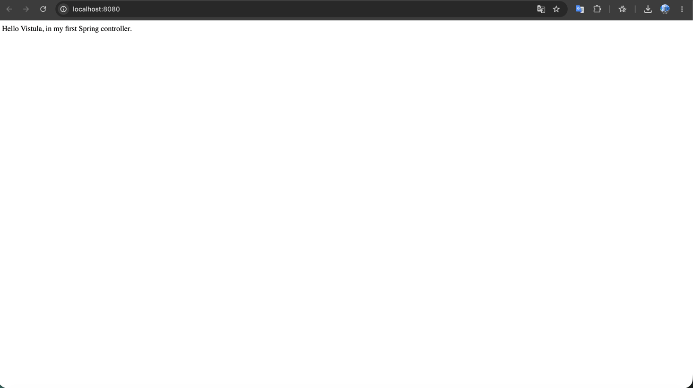
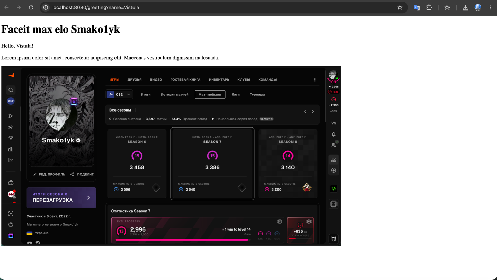

# Project1ArtemMatyrin

My first Spring Boot app (Exercise 16, Task 1).

The project was created with [Spring Initializr](https://start.spring.io/) (Maven, Java, Spring Web, Thymeleaf, Lombok).
It has one controller, `HelloController`, with two endpoints:

- `/` – returns plain text thanks to `@ResponseBody`
- `/greeting?name=Vistula` – returns a Thymeleaf view (`greeting.html`) with a picture

## @ResponseBody

In a class marked with `@Controller`, a returned `String` is treated as the name of a view.
With `@ResponseBody` the `String` is sent directly to the browser as the response body.
`@RestController` adds `@ResponseBody` to every method, so the class uses `@Controller` to be able to return the `greeting` view.

## How to run

Run `Project1ArtemMatyrinApplication` in IntelliJ IDEA (or `./mvnw spring-boot:run`) and open:

- http://localhost:8080/
- http://localhost:8080/greeting?name=Vistula

## Screenshots

